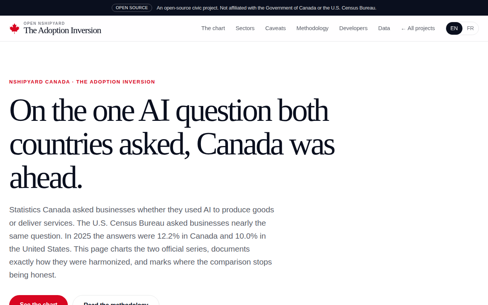

# The Adoption Inversion



**Live:** https://adoption.canada.nshipyard.com

On the one AI-adoption survey question Canada and the United States asked businesses in nearly identical words, which country is actually ahead? In 2025 the answers were **12.2% in Canada** (Statistics Canada, Canada's national statistical agency, Q2 2025) and **10.0% in the United States** (the U.S. Census Bureau's Business Trends and Outlook Survey, or BTOS, September 2025, legacy wording). This site charts the two official series, documents exactly how they were harmonized, and marks where the comparison stops being honest.

An Open Nshipyard civic-data project. Open source, MIT licensed. Not affiliated with the Government of Canada or the U.S. Census Bureau.

## What the page shows

- **Headline comparison:** 12.2% (Canada, Q2 2025) vs 10.0% (US, Sept 2025), the 2025 answers to the nearly identically worded AI-use question.
- **Harmonized time series chart:** Canada's quarterly Canadian Survey on Business Conditions (CSBC) series (6.1% Q2 2024, 12.2% Q2 2025, 19.2% Q2 2026) against the Census Bureau's fortnightly BTOS legacy-wording series (3.7% Sept 2023, 6.0% Sept 2024, 10.0% Sept 2025), with a break line where the Census changed the question on November 17, 2025 and started a new series.
- **Sector comparison (2025):** information and cultural industries 35.6% vs 29.3%, professional/scientific/technical services 31.7% vs 23.9%, finance and insurance 30.6% vs 17.1% (Canada Q2 2025 vs US Sept 2025 fortnight).
- **Firm-size panel:** US-only, because Statistics Canada's firm-size cube (Table 33-10-1005) was not retrievable at build time; the StatCan bulk CSV download served stale content for that table.
- **English/French toggle**, methodology section, and honest-caveats panel on the page itself.
- **API:** `GET /api/v1/series` (harmonized series), `GET /api/v1/sectors` (sector comparison), `GET /api/v1/meta` (headline, caveat, sources), `GET /api/openapi.json` (OpenAPI 3.1 spec).
- **MCP server:** `POST /mcp` over streamable HTTP with tools `series_lookup`, `sector_comparison`, `firmsize_us`, and `coverage`, so AI agents can query the same numbers programmatically.

## The data

Every U.S. figure on this page was pulled from the Census Bureau's own files on 2026-10-09 and cross-checked against the build spec's curated figures. They matched exactly.

- **US legacy-wording series:** national "Yes" shares on "used AI in producing goods or services": 3.7% (Sept 2023), 6.0% (Sept 2024), 10.0% (Sept 2025), from the Census "AI Core Questions" download file.
- **Question break:** the Census switched to "in any of its business functions" on November 17, 2025 and began a new time series December 4, 2025. Only pre-break fortnights are charted; post-break values are not spliced in.
- **Canada series:** 6.1% (Q2 2024), 12.2% (Q2 2025), 19.2% (Q2 2026), transcribed from Statistics Canada's CSBC analytical publications 11-621-m2025008 and 11-621-m2026010 (the publications cite CSBC Table 33-10-1004-01).

### Honest caveats (also on the page)

- **Reference windows differ:** StatCan asks about the 12 months preceding the survey; BTOS asks about the last two weeks. A 12-month window mechanically raises the yes share, so part of Canada's lead reflects the window, not only adoption.
- **Firm-size cuts:** StatCan publishes them in Table 33-10-1005, which was not retrievable at build time, so the firm-size panel is U.S.-only.
- **Firm-count weighting:** both surveys weight by firm count, not employment. Canada's SME-heavy economy (SMEs employ roughly 64% of private-sector workers, per Innovation, Science and Economic Development Canada) mechanically depresses firm-count-weighted adoption.

## Data sources

- Statistics Canada, Canadian Survey on Business Conditions: https://www150.statcan.gc.ca/n1/pub/11-621-m/11-621-m2025008-eng.htm and https://www150.statcan.gc.ca/n1/pub/11-621-m/11-621-m2026010-eng.htm
- U.S. Census Bureau, Business Trends and Outlook Survey downloads: https://www.census.gov/hfp/btos/downloads/ (AI Core Questions file, legacy wording series; question-change notice "AI Question Wording Updates", December 3, 2025)

## Methodology summary

1. Pull the Census AI Core Questions file; extract national "Yes" for all fortnights; label the September reference points.
2. Transcribe StatCan headline and sector figures from the analytical publications (bulk CSV served stale content for this cube; transcription double-checked against the publication).
3. Map sectors: StatCan "information and cultural industries" to NAICS 51; "finance and insurance" to NAICS 52; "professional, scientific and technical services" to NAICS 54. Documented, not adjusted.
4. Chart only pre-November-2025 US fortnights; draw the break line; never splice post-break values.
5. Quarterly updates: re-pull both sources, append the new points, re-verify September labels; if the Census changes wording again, freeze and draw a new break.

Full methodology with the update procedure is on the site's Methodology section. Reproducible pipeline: `scripts/build_data.py` (reads `scripts/sources/btos_ai_core.xlsx`, writes `public/data/`).

## Screenshots

### Landing (EN)


### Desktop (FR)


### Mobile (EN)


### Hero chart


## Development

```bash
npm install
npm run dev      # http://localhost:3000
npm run build    # production build
```

## Built by

**Richardson Dackam** - https://x.com/richardsondx - https://github.com/richardsondx
